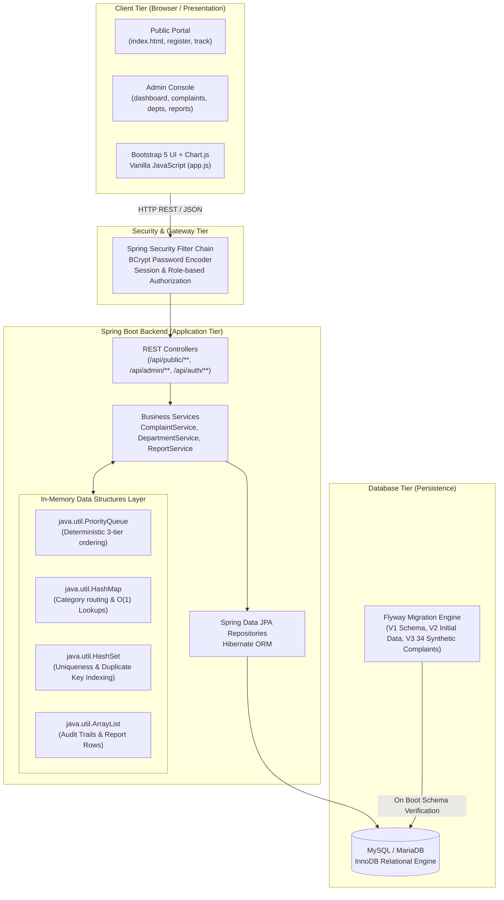

# System Architecture Document
## Makkal Nagar Municipal Corporation — Grievance Management System

This document outlines the multi-tier enterprise architecture of the Makkal Nagar portal.

---

### Tier Breakdown

#### 1. Presentation Tier (Frontend)
- **HTML5 & CSS3**: Pure Semantic HTML5 with an accessible, high-contrast civic theme (`#0a192f` Navy, `#0d9488` Teal, `#f8fafc` Light Gray).
- **Bootstrap 5**: Responsive flexbox and grid layouts supporting mobile, tablet, and widescreen desktop presentation.
- **Chart.js**: Dynamic data visualizations (Doughnut status distribution, category breakdown bars, and department workload comparisons).
- **Vanilla JavaScript**: Lightweight modular client architecture (`app.js`) handling asynchronous REST communication, validation, state management, and real-time DOM updates without framework bloat.

#### 2. Security Tier
- **Spring Security 6**: Formulates stateless or session-backed protection.
- **BCrypt**: Secure one-way salt and hashing (`strength = 10`) protecting user passwords.
- **Endpoint Segmentation**:
  - Public (`/api/public/**`, `/api/auth/**`, static pages): Anonymous access.
  - Administrative (`/api/admin/**`): Enforces `ROLE_ADMIN` authority. Unauthenticated requests receive RFC-standard `401 Unauthorized` JSON responses.

#### 3. Application Tier (Spring Boot)
- **Dependency Injection**: Loose coupling managed by Spring IoC container.
- **Transactional Consistency**: `@Transactional` boundaries guarantee database consistency during multi-step operations (e.g., resolving a complaint + freeing capacity + auto-dispatching the next queued grievance).
- **Atomic Arrival Sequencing**: Safe sequence incrementing prevents concurrent race conditions without slow `MAX(arrival_order) + 1` locks.

#### 4. Data Structures Layer
- **`PriorityQueue<Grievance>`**: Maintained per department for complaints waiting for capacity. Enforces $O(\log n)$ priority extraction.
- **`HashMap<Category, Department>`**: Constant time $O(1)$ routing from complaint categories to responsible departments.
- **`HashSet<String>`**: Ensures unique complaint ID sets and rapid duplicate key candidate evaluation.
- **`ArrayList<T>`**: Preserves sequential history events, assignments, and tabular analytics.
- **Sorting Algorithms**: Custom `Comparator`-based multi-attribute sorting for queue extraction, department workload rankings, and grievance aging analysis.

#### 5. Database Tier
- **MySQL 8 / MariaDB**: Fully normalized schema enforcing referential integrity with foreign key cascades and indexes.
- **Flyway**: Automated database versioning and repeatable migration scripts (`V1__create_schema.sql`, `V2__seed_initial_data.sql`, `V3__seed_synthetic_complaints.sql`).
