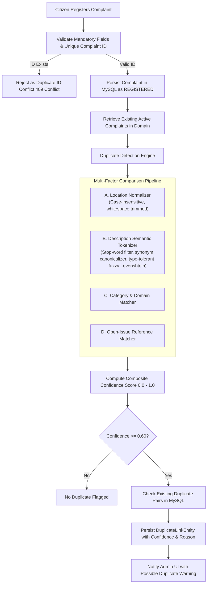
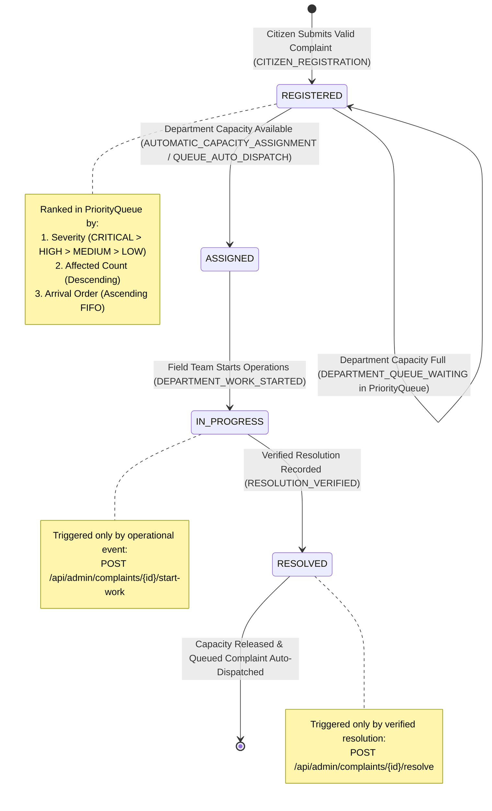

# Intelligent Duplicate Detection & Automatic Status Management
## Makkal Nagar Municipal Corporation — Grievance Management System

This document provides a comprehensive technical specification of the Intelligent Duplicate Detection Engine and the Automatic Complaint Status Management Lifecycle implemented in the Makkal Nagar Grievance Management System.

---

## 1. Intelligent Automatic Duplicate Detection

### 1.1 Architectural Overview
The duplicate detection engine operates automatically within the Java backend during grievance registration (`POST /api/public/complaints`). Administrators are **not required** to manually review, flag, or confirm duplicate relationships; the system computes a multi-factor confidence score, automatically flags duplicates, and persists detection results and explanations directly into the MySQL database.

---

### 1.2 Comparison Factors & Weights

The detection engine evaluates candidates across four distinct factors:

| Factor | Weight ($W_i$) | Matching Methodology |
|---|---|---|
| **Open-Issue Reference** | **0.35** | Exact case-insensitive match on normalized issue reference tokens (e.g., `#PIPE-2026-08`, `ISSUE-44`). |
| **Location Matching** | **0.30** | Case-insensitive, whitespace-collapsed equality and ward-level containment (e.g., `" Anna Nagar "` $\equiv$ `"anna nagar"`). |
| **Category Matching** | **0.15** | Domain-level category equality (`WATER`, `ROAD`, `STREETLIGHT`, `WASTE`). |
| **Description Similarity** | **0.20** | Multi-step NLP keyword similarity (stop-word removal, synonym unification, typo-tolerant Levenshtein distance, and Jaccard token overlap). |

#### Guardrail Against Single Common Word Matches
To avoid false positives, the engine enforces a strict constraint: **a single shared common keyword alone cannot trigger a duplicate match**. Token overlap requires either:
1. Two or more distinct domain keywords matching (e.g., `["water", "leak"]`), or
2. High overall token similarity ($\ge 0.50$) combined with matching location and category.

---

### 1.3 Natural Language Text Processing Pipeline

1. **Tokenization & Case Normalization**: Text is transformed to lowercase; punctuation and numerical symbols are stripped.
2. **Stop-Word Removal**: 60+ English function words (`the`, `is`, `at`, `which`, `on`, `and`, etc.) are removed to isolate domain keywords.
3. **Synonym Canonicalization**: Municipal terminology is mapped to canonical stems:
   - `pothole`, `crater`, `cavity` $\rightarrow$ `pothole`
   - `burst`, `break`, `leak`, `rupture` $\rightarrow$ `leak`
   - `garbage`, `trash`, `waste`, `rubbish` $\rightarrow$ `garbage`
   - `dark`, `unlit`, `blackout`, `flicker` $\rightarrow$ `dark`
4. **Typo-Tolerant Fuzzy Matching**: Tokens are compared using the Levenshtein edit distance metric:
   $$\text{sim}(t_1, t_2) = 1.0 - \frac{\text{Levenshtein}(t_1, t_2)}{\max(\text{len}(t_1), \text{len}(t_2))}$$
   Tokens with similarity $\ge 0.80$ (e.g., `"overflowing"` vs `"overflwing"`) are matched.
5. **Jaccard Token Metric**:
   $$J(A, B) = \frac{|A \cap B|}{|A \cup B|}$$

---

### 1.4 Confidence Thresholds & Actions

$$\text{Confidence Score} = W_{\text{ref}} \cdot S_{\text{ref}} + W_{\text{loc}} \cdot S_{\text{loc}} + W_{\text{cat}} \cdot S_{\text{cat}} + W_{\text{desc}} \cdot S_{\text{desc}}$$

- **Score $< 0.60$**: Discarded. Not considered a duplicate candidate.
- **Score $0.60 \le S < 0.85$**: Automatically classified as **`POSSIBLE_DUPLICATE`**. Displayed to administrators with a warning banner, similarity details, and related complaint links.
- **Score $\ge 0.85$**: Automatically classified as **`CONFIRMED_DUPLICATE`** (High Confidence). Highlighted in administrative views with high-priority warnings.

#### Non-Destructive Preservation Policy
- Neither complaint is ever silently deleted, dropped, or merged.
- Both complaints remain fully queryable, trackable by citizens, and preserved in the audit log.
- Duplicate warnings do not block genuine complaints from being investigated.
- Bidirectional lookup (`c1 -> c2` or `c2 -> c1`) prevents redundant duplicate link records from polluting the MySQL database.

---

### 1.5 Algorithm Limitations
1. **Language Scope**: Currently optimized for English municipal reports; vernacular Tamil transliterations are matched where keyword tokens align.
2. **Short Descriptions**: Descriptions with fewer than 3 significant words rely heavily on Category and Location matching.
3. **Geographic Coordinates**: Matching operates at ward/street name granularity; geo-spatial GPS radius clustering is an available enhancement when coordinates are provided.

---

## 2. Automatic Complaint Status Management

### 2.1 Enforced Lifecycle State Machine

Administrators are **strictly prohibited** from manually selecting a complaint's status using dropdowns or arbitrary update buttons. All status transitions are driven by verified backend events.

---

### 2.2 Event Triggers and Status Rules

#### A. `REGISTERED`
- **Trigger**: Citizen submits a complaint through public registration (`POST /api/public/complaints`).
- **Automation**: The backend creates the record with status `REGISTERED` and logs event `CITIZEN_REGISTRATION`.
- **Queue Check**: The system immediately evaluates responsible department active cases versus capacity:
  - If `activeCases < capacity`: Automatically promoted to `ASSIGNED` (`AUTOMATIC_CAPACITY_ASSIGNMENT`).
  - If `activeCases >= capacity`: Enqueued in the department's `PriorityQueue` (`DEPARTMENT_QUEUE_WAITING`).

#### B. `ASSIGNED`
- **Trigger**: Successful allocation of department capacity upon submission or queue promotion.
- **Automation**: Department active case counter increases; status update record persisted.
- **Rule**: If department is at full capacity, the complaint remains `REGISTERED` in the queue.

#### C. `IN_PROGRESS`
- **Trigger**: Department officer/crew initiates field work (`POST /api/admin/complaints/{id}/start-work`).
- **Automation**: Validates current status is `ASSIGNED`. Updates status to `IN_PROGRESS` with event `DEPARTMENT_WORK_STARTED`.
- **Rule**: Viewing or opening a complaint does **not** alter its status.

#### D. `RESOLVED`
- **Trigger**: Engineering resolution verified and submitted (`POST /api/admin/complaints/{id}/resolve`).
- **Automation**: Validates current status is `IN_PROGRESS`. Sets `resolved_at`, records resolution notes, logs event `RESOLUTION_VERIFIED`, releases 1 department capacity slot, and triggers **Automatic Queue Processing**.

---

### 2.3 Automatic Priority Queue Dispatch on Resolution

When a complaint is resolved in Department $D$:
1. Current active count is decremented ($C_{\text{active}} \leftarrow C_{\text{active}} - 1$).
2. While $C_{\text{active}} < C_{\text{limit}}$ and waiting complaints exist in $D$'s `PriorityQueue`:
   - Dequeue the highest-priority waiting complaint:
     $$\text{Priority: } \text{Severity Weight} \downarrow \;\rightarrow\; \text{Affected Count} \downarrow \;\rightarrow\; \text{Arrival Order} \uparrow$$
   - Update its status to `ASSIGNED`.
   - Log assignment trail and status update with triggering event `QUEUE_AUTO_DISPATCH`.
   - Increment $C_{\text{active}}$.
3. All operations run inside an ACID `@Transactional` boundary preventing race conditions.

---

### 2.4 Status History Schema in MySQL

Every status change is recorded in the `status_updates` table:

| Column | Type | Description |
|---|---|---|
| `id` | `BIGINT AUTO_INCREMENT` | Primary Key |
| `complaint_id` | `BIGINT` | Foreign Key to `complaints.id` |
| `previous_status` | `VARCHAR(30)` | Previous lifecycle state (`REGISTERED`, `ASSIGNED`, etc.) |
| `new_status` | `VARCHAR(30)` | Updated lifecycle state |
| `triggering_event` | `VARCHAR(60)` | Machine event (`CITIZEN_REGISTRATION`, `RESOLUTION_VERIFIED`, etc.) |
| `changed_by` | `VARCHAR(100)` | Responsible user or system process (`admin`, `system-priority-dispatcher`) |
| `remarks` | `VARCHAR(500)` | Detailed justification or engineering notes |
| `created_at` | `DATETIME(6)` | High-precision audit timestamp |

---

## 3. Automated Test Verification Results

All 22 automated tests across all 5 test suites pass with **0 failures and 0 errors**:

| # | Test Method | Test Suite | Verified Scenario | Status |
|---|---|---|---|---|
| 1 | `testIdenticalDescriptionsAtSameLocation` | `ComplaintServiceIntegrationTest` | Identical description & same location detected as duplicate (Confidence $\ge 0.85$) | **PASSED** |
| 2 | `testSimilarDescriptionsDifferentWording` | `ComplaintServiceIntegrationTest` | Synonym & wording variation detected via NLP keywords (Confidence $\ge 0.60$) | **PASSED** |
| 3 | `testSameLocationUnrelatedComplaints` | `ComplaintServiceIntegrationTest` | Same location with completely unrelated issue is NOT flagged as duplicate | **PASSED** |
| 4 | `testSimilarDescriptionsDifferentLocations` | `ComplaintServiceIntegrationTest` | Similar text at different locations is NOT flagged as duplicate | **PASSED** |
| 5 | `testDifferentComplaintIdsSameIssue` | `ComplaintServiceIntegrationTest` | Different complaint IDs reporting the same issue are linked as duplicate candidates | **PASSED** |
| 6 | `testRepeatedComplaintIdRejection` | `ComplaintServiceIntegrationTest` | Duplicate/reused complaint ID is rejected as an ID conflict (throws `ConflictException`) | **PASSED** |
| 7 | `testMultiplePossibleDuplicateCandidates` | `ComplaintServiceIntegrationTest` | Newly submitted issue matching multiple existing issues correctly links to all candidates | **PASSED** |
| 8 | `testDepartmentWorkStartedTransition` | `ComplaintServiceIntegrationTest` | `startDepartmentWork` transitions `ASSIGNED -> IN_PROGRESS` with event `DEPARTMENT_WORK_STARTED` | **PASSED** |
| 9 | `testResolutionVerifiedAndAutoDispatch` | `ComplaintServiceIntegrationTest` | `recordVerifiedResolution` transitions `IN_PROGRESS -> RESOLVED`, frees slot, auto-dispatches waiting complaint | **PASSED** |
| 10 | `testInvalidStatusTransitionRejected` | `ComplaintServiceIntegrationTest` | Illegal transitions (e.g. `REGISTERED -> RESOLVED`) are rejected with `InvalidOperationException` | **PASSED** |
| 11 | `testManualStatusModificationProhibited` | `ComplaintServiceIntegrationTest` | Direct call to `updateStatus` is strictly prohibited and throws exception | **PASSED** |
| 12 | `testStatusHistoryPersistedWithTriggeringEvent`| `ComplaintServiceIntegrationTest` | Validates MySQL persistence of `previous_status`, `new_status`, `triggering_event`, actor, and remarks | **PASSED** |
| 13-17 | `PriorityQueueAndOrderingTest` (5 tests) | `PriorityQueueAndOrderingTest` | Deterministic severity, affected-count, and arrival order queue ranking | **PASSED** |
| 18 | `testDepartmentCapacityConstraints` | `DepartmentCapacityTest` | Department capacity bounds enforcement | **PASSED** |
| 19-20 | `AdminControllerSecurityTest` (2 tests) | `AdminControllerSecurityTest` | Security authorization, 401 handling, and dashboard telemetry | **PASSED** |
| 21-22 | `GrievanceDomainOopTest` (2 tests) | `GrievanceDomainOopTest` | OOP encapsulation, immutable ID, and domain lifecycle rules | **PASSED** |

**Command**: `mvn test` in `backend`  
**Execution Result**: `Tests run: 22, Failures: 0, Errors: 0, Skipped: 0` &bull; **BUILD SUCCESS**
