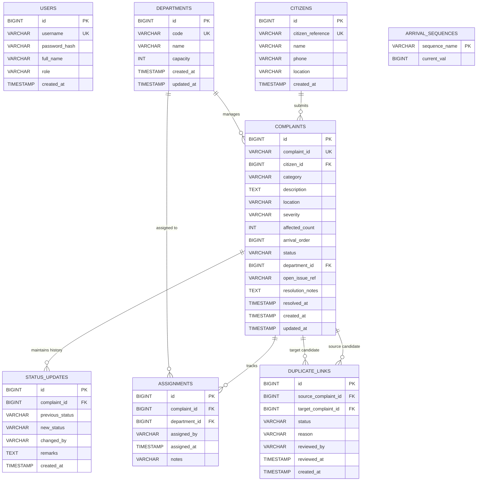

# Entity Relationship (ER) Diagram
## Makkal Nagar Municipal Corporation — Grievance Management System

This document outlines the relational database schema implemented in MySQL, managed through Flyway migrations.

---

### Key Relationships & Data Integrity Constraints:
1. **Citizens to Complaints**: One-to-Many (`citizens.id -> complaints.citizen_id`). Protects citizen profiles from accidental deletion when complaints exist (`ON DELETE RESTRICT`).
2. **Departments to Complaints**: One-to-Many (`departments.id -> complaints.department_id`).
3. **Audit Trails**:
   - `status_updates` maintains an immutable append-only log of lifecycle changes (`REGISTERED -> ASSIGNED -> IN_PROGRESS -> RESOLVED`).
   - `assignments` preserves department routing history and reassignment justifications.
4. **Duplicate Linking**: Many-to-Many self-referential association via `duplicate_links` (`source_complaint_id`, `target_complaint_id`).
5. **Deterministic Arrival Sequence**: `arrival_sequences` table updated via pessimistic row locking to guarantee atomic FIFO arrival indexing without race conditions.
