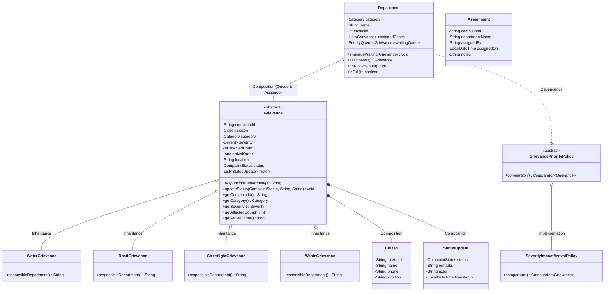

# UML Class Diagram & Object-Oriented Design
## Makkal Nagar Municipal Corporation — Grievance Management System

This document visualizes the object-oriented architecture and explains how core OOP concepts are demonstrated in the codebase.

---

### Implementation of Object-Oriented Programming (OOP) Concepts:

1. **Encapsulation**:
   - Class state is kept strictly private (e.g. `Grievance`, `Department`).
   - Mutations are encapsulated behind domain methods (e.g., `Grievance.updateStatus()`, `Department.setCapacity()`).
   - `updateStatus()` validates allowed state machine transitions (`REGISTERED -> ASSIGNED -> IN_PROGRESS -> RESOLVED`) before altering internal state, ensuring integrity.

2. **Inheritance**:
   - `WaterGrievance`, `RoadGrievance`, `StreetlightGrievance`, and `WasteGrievance` inherit all common attributes and methods from the abstract base class `Grievance`.
   - Code duplication is eliminated while allowing category-specific behaviors.

3. **Polymorphism**:
   - The abstract method `responsibleDepartment()` in `Grievance` is polymorphically implemented across subclasses:
     - `WaterGrievance` returns `"Water Supply Department"`.
     - `RoadGrievance` returns `"Roads and Infrastructure Department"`.
     - `StreetlightGrievance` returns `"Streetlight and Electrical Department"`.
     - `WasteGrievance` returns `"Sanitation and Waste Management Department"`.
   - Callers execute `grievance.responsibleDepartment()` without needing `if-else` or `switch` type checks.

4. **Abstraction**:
   - `GrievancePriorityPolicy` provides an abstract contract defining `comparator()`.
   - The concrete class `SeverityImpactArrivalPolicy` encapsulates the multi-tier ranking logic.
   - The `Department` waiting queue relies on the policy abstraction, remaining completely decoupled from how priority scores are computed.

5. **Composition**:
   - A `Department` has-a `PriorityQueue<Grievance>` and has-a `List<Grievance>` of active cases.
   - A `Grievance` has-a `Citizen` and has-a `List<StatusUpdate>` representing its immutable historical audit trail.
